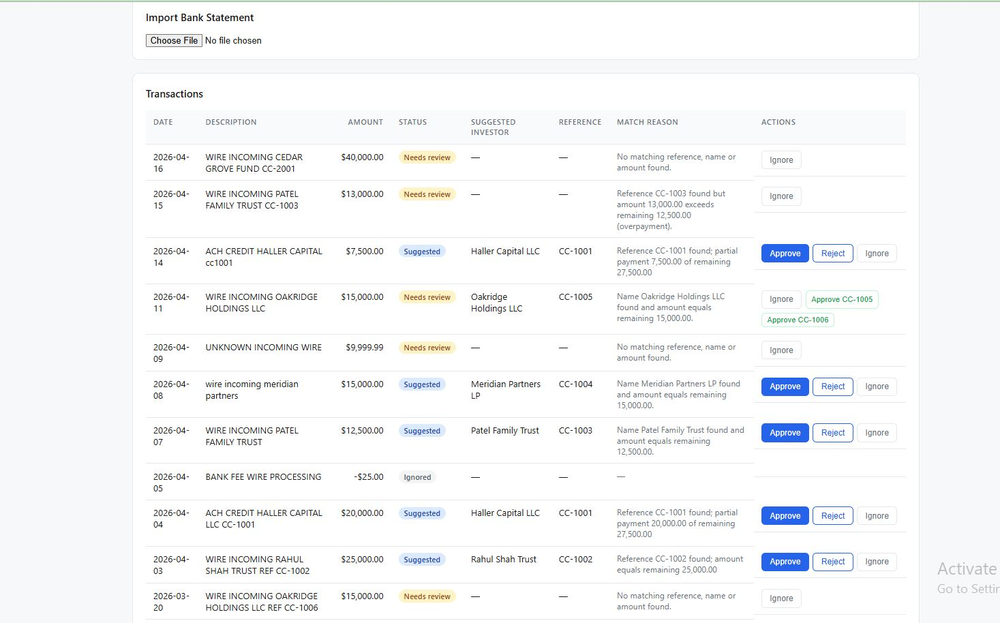
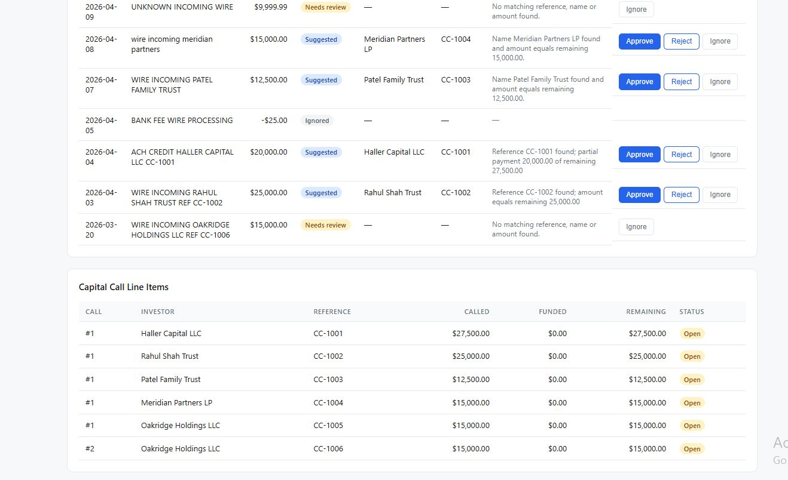

# CapitalRecon

**CapitalRecon** is a bank reconciliation tool for fund administrators. It imports bank statement CSVs, matches incoming wire payments to capital call line items, and lets General Partners (GPs) approve, reject, or ignore each suggestion.

Built with **Django + Django REST Framework** (backend), **React + Vite** (frontend), and **PostgreSQL** (with a local SQLite fallback).

---

## Demo Video Walkthrough

Watch the full demo — seed data, CSV import, matching suggestions, approvals, and organization switching:

<video width="100%" controls>
  <source src="Untitled design.mp4" type="video/mp4">
</video>

[Download video](Untitled design.mp4)

---

## Screenshots

### Transaction matching with suggestions



### Line items and funding status



---

## Features

- **CSV Import** — Upload a bank statement CSV. Validates dates, amounts (stored as `Decimal`, never float), credit/debit signs, and references. Skips invalid and duplicate rows with line-numbered error reports.
- **Intelligent Matching** —
  - Matches by expected wire reference (case-insensitive, e.g. `cc-1003` → `CC1003`).
  - Falls back to investor name + exact amount match.
  - Flags overpayments and multiple candidates as `needs_review`.
- **Reconciliation Actions** — Approve (atomically, with re-check for overpayment and double-funding protection), reject, or ignore transactions.
- **Multi-tenant** — Full organization isolation via the `X-Organization` header. One org never sees another's data.
- **React UI** — Organization switcher, CSV upload with import summary, transaction table with per-row actions, and a line-item panel. Loading, empty, and error states.

---

## Tech Stack

| Layer | Technology |
|-------|-----------|
| Backend | Django 6, Django REST Framework |
| Frontend | React 19, Vite |
| Database | PostgreSQL (SQLite fallback for local dev) |
| Styling | Plain CSS |

---

## Getting Started

### Prerequisites

- Python 3.11+
- Node.js 18+
- PostgreSQL (optional — falls back to SQLite)

### Backend

```bash
cd backend
python -m venv .venv
.venv\Scripts\activate          # Windows
# source .venv/bin/activate     # macOS/Linux
pip install -r requirements.txt

# Configure environment (optional)
cp .env.example .env            # edit as needed

python manage.py migrate
python manage.py seed_demo
python manage.py runserver 8000
```

### Frontend

```bash
cd frontend
npm install
npm run dev
```

Open **http://localhost:5173** in your browser.

---

## Environment Variables

See [`.env.example`](.env.example) for the full list. Key variables:

| Variable | Description |
|----------|-------------|
| `DJANGO_SECRET_KEY` | Django secret key |
| `DEBUG` | `1` for development, `0` for production |
| `DB_ENGINE` | Set to `django.db.backends.postgresql` to use Postgres; omit for SQLite |
| `DB_NAME`, `DB_USER`, `DB_PASSWORD`, `DB_HOST`, `DB_PORT` | PostgreSQL connection |
| `CORS_ALLOWED_ORIGINS` | Allowed frontend origins (comma-separated) |
| `AIRTABLE_API_KEY`, `AIRTABLE_BASE_ID`, `AIRTABLE_TABLE_ID` | Optional Airtable sync for `needs_review` items |

---

## Running Tests

```bash
cd backend
python manage.py test capitalrecon.tests -v 2
```

The test suite covers all 8 minimum cases: missing column, amount parsing, duplicates, reference matching, name+amount matching, overpayment, approve with 409 on double-approval, and organization isolation.

---

## API Endpoints

All requests (except `GET /api/organizations/`) require the header `X-Organization: <slug>`.

| Method | Path | Description |
|--------|------|-------------|
| `GET` | `/api/organizations/` | List all organizations |
| `POST` | `/api/import/` | Upload a CSV (multipart field `file`) |
| `GET` | `/api/transactions/` | List transactions (newest first) with matches |
| `GET` | `/api/line-items/` | List capital call line items |
| `POST` | `/api/matches/{id}/approve/` | Approve a proposed match |
| `POST` | `/api/matches/{id}/reject/` | Reject a proposed match |
| `POST` | `/api/transactions/{id}/ignore/` | Ignore a transaction |

---

## Project Structure

```
h:\alpha\
├── backend/
│   ├── capitalrecon/
│   │   ├── management/commands/seed_demo.py   # Idempotent seed data
│   │   ├── migrations/                        # Database migrations
│   │   ├── services/
│   │   │   ├── import_service.py             # CSV parsing & validation
│   │   │   ├── matching.py                   # Matching engine
│   │   │   ├── normalization.py              # Reference & name normalization
│   │   │   └── reconciliation.py             # Approve/reject/ignore (atomic)
│   │   ├── tests/                            # Test suite
│   │   ├── middleware.py                     # X-Organization scoping
│   │   ├── models.py                         # Data models
│   │   ├── serializers.py                    # DRF serializers
│   │   ├── urls.py                           # URL routing
│   │   └── views.py                          # API views
│   └── config/                               # Django settings & config
├── frontend/
│   └── src/
│       ├── App.jsx                           # Main React page
│       ├── api.js                            # API client
│       └── App.css                           # Styles
├── .env.example
├── ASSESSMENT_NOTES.md                       # Detailed assessment notes
└── sample_bank_statement.csv                 # Sample CSV for testing
```

---

## License

Internal assessment submission — Digital Alpha Full Stack Intern Technical Assessment.
